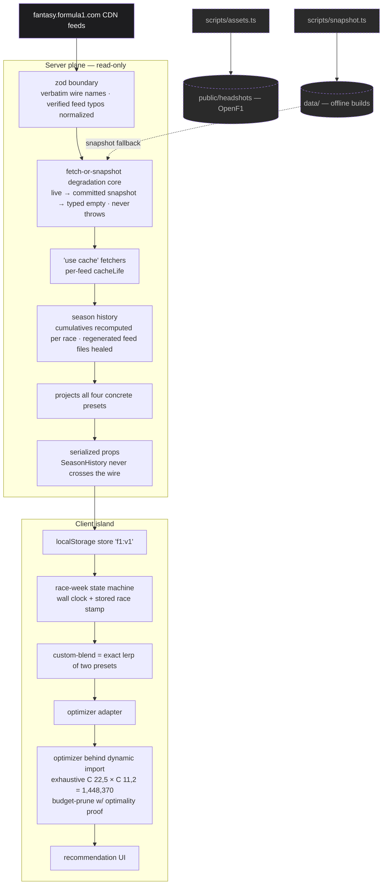

# Fantasy F1 Race-Weekend Advisor

**Finds the provably optimal F1 Fantasy squad and transfers for the next Grand Prix by checking all 1,448,370 legal squads in ~6 ms, right in the browser.**

Exact, not heuristic: given the projections, no better squad exists. It pulls the official F1 Fantasy feeds, projects every driver and constructor under transparent presets, and explains every number. Free, no login; your team lives in `localStorage` only.

- **Exact search with a proof.** Budget-only pruning with a written optimality proof. Tests check the global optimum _and_ the best squad at every transfer count against a brute-force oracle.
- **Degrades instead of breaking.** Every feed is validated with zod at the boundary and falls back from live to committed snapshot to typed empty. The production build succeeds with the feeds unreachable.
- **Next.js 16 Cache Components.** A cacheable static shell with one streamed data hole. Lighthouse 100 on Accessibility, Best Practices and SEO; LCP 407 ms at 4× CPU throttle.
- **Tested and strictly typed.** 320 tests (Vitest + Testing Library), strict TypeScript with `noUncheckedIndexedAccess`.

**Stack:** Next.js 16 (App Router, Cache Components) · React 19 · TypeScript · Tailwind CSS v4 · shadcn/ui · zod · Vitest

## Screenshots

Light by default on a dot-pattern paper grey, with a dark "telemetry" theme one toggle away. The recommended transfers and DRS Boost are baked directly into your roster rows.

| The advisor — live Monaco data                                 | Team setup                                      | Stats                                |
| -------------------------------------------------------------- | ----------------------------------------------- | ------------------------------------ |
|  |  |  |

## How it works



The server resolves a single streamed data hole (a fully cacheable async RSC, no `searchParams`, no wall clock), pre-computes the four concrete presets, and ships serializable ingredients. The client island runs the race-week state machine itself, derives `custom-blend` by exact interpolation, and only then lazy-loads the optimizer.

## Key decisions

| Decision                                                               | Why                                                                                                    |
| ---------------------------------------------------------------------- | ------------------------------------------------------------------------------------------------------ |
| Exhaustive search, budget-only pruning with a written optimality proof | Score/upper-bound pruning deliberately omitted — it could cut a non-global per-transfer-count optimum  |
| Oracle-verified optimality                                             | Tested against a brute-force oracle — global optimum and every transfer bucket                         |
| DRS captain co-optimized for free                                      | Captain is the max-projection term folded into the score, not a second pass                            |
| Money is integer tenths-of-a-million end to end                        | Exact budget-boundary comparisons (cost == purse affordable; one tenth more is not)                    |
| Season cumulatives recomputed by summing per-race points               | Feed totals are contaminated — old race files get regenerated with later-era cumulatives               |
| Team lock from the raceday ISO8601 first-session start                 | `constraints.DeadlineDate` proven stale/advisory — never trusted                                       |
| Never recompute scoring from results                                   | The feed's per-race / per-session points suffice; no re-derivation                                     |
| Committed snapshots feed offline builds                                | `'use cache'` fetchers fall back to `data/`, so `next build` never needs the live feeds                |
| Sprint small-sample prior                                              | Sprint sessions are shrunk toward a prior (few samples per season)                                     |
| Equal-PPM is per-race calibrated                                       | Divides by completed races so it sits on the single-race scale as a fallback                           |
| `custom-blend` = exact lerp of season-average and weighted-recent      | The engine's blend is linear in its endpoints, so SeasonHistory never has to ship                      |
| Race-week state machine runs client-side                               | It needs wall clock + stored race; nothing time/user-dependent in the PPR shell                        |
| `localStorage`-only persistence                                        | No accounts, no backend; degrades silently when storage is blocked                                     |
| Light default via `next-themes` pre-paint script                       | Zero FOUC and PPR-safe: the static shell stays theme-free; the class lands before first paint          |
| Text and surface tokens are designed as pairs                          | Muted-on-raised-grey and white-on-red-fill each fail AA if tuned alone — found by auditing both themes |
| Recommended plan baked into the roster rows                            | One merged team card (out → in per row, DRS chip on the pick) beats two cards saying the same thing    |
| Picker = two kind tables + one shared search                           | A checkbox column is the a11y source of truth; sort/announce mechanics shared with the stats table     |
| Dot-pattern background generated by a seeded PRNG                      | The speckle SVGs are deterministic build inputs (`pnpm pattern`), not random output                    |

## Performance

Optimizer microbenchmark — Apple M1 Pro, node 22; 1,448,370 candidate squads; 50 warmup + 500 measured runs × 3 seeds. Reproduce with `pnpm bench`.

| mode      | min ms | median ms | p95 ms |
| --------- | ------ | --------- | ------ |
| normal    | 4.826  | 6.267     | 7.246  |
| wildcard  | 4.724  | 6.061     | 7.053  |
| limitless | 6.632  | 6.872     | 7.204  |

Production build: Lighthouse 100/100/100 (Accessibility / Best Practices / SEO) on `/` (desktop and mobile) and `/stats`, plus 100 Accessibility on the fully expanded advisor in both themes. LCP 407 ms at 4× CPU throttle (the text hero is the LCP element), CLS 0.00. The optimizer runs in ~25 ms even at 4× throttle, so it stays on the main thread inside a `startTransition` — no Web Worker needed.

## Commands

Requires Node ≥ 20.9 and pnpm. Run `pnpm install` first.

| Command             | What it does                                                             |
| ------------------- | ------------------------------------------------------------------------ |
| `pnpm dev`          | Start the dev server                                                     |
| `pnpm build`        | Production build                                                         |
| `pnpm start`        | Serve the production build                                               |
| `pnpm test`         | Run the suite (320 tests)                                                |
| `pnpm bench`        | Optimizer microbenchmark (the perf record)                               |
| `pnpm snapshot`     | Refresh committed feed snapshots in `data/`                              |
| `pnpm assets`       | Download OpenF1 headshots (blocked during live sessions; always exits 0) |
| `pnpm pattern`      | Regenerate the dot-pattern background SVGs (seeded, deterministic)       |
| `pnpm lint`         | ESLint                                                                   |
| `pnpm format:check` | Prettier check                                                           |
| `pnpm typecheck`    | `next typegen && tsc --noEmit`                                           |

The build never needs the live feeds. With the feed pointed at an unreachable host, it still succeeds end to end and renders snapshot data with provenance:

```sh
F1_FEED_BASE=http://127.0.0.1:1 pnpm build
```

## Honesty notes

- Projections are small-sample means; the optimizer maximizes expected points, it does not predict the future.
- Per-preset confidence ("based on N completed races") is shown in-app, and history-based presets are greyed at cold start.
- In the post-race transient window the state machine enters `BETWEEN_ROUNDS`, suppressing stale numbers until the next round's data publishes.

## Credits & disclaimer

Unofficial fan project. Not affiliated with, endorsed by, or associated with the Formula One group of companies, the FIA, or F1 Fantasy. Driver imagery via [OpenF1](https://openf1.org) (CC BY-NC-SA); schedule cross-checks via [Jolpica F1](https://github.com/jolpica/jolpica-f1); data sourced from the public F1 Fantasy CDN feeds.
