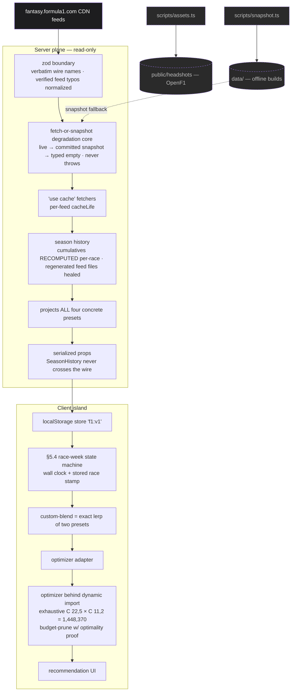

# Fantasy F1 Race-Weekend Advisor

A free, no-login web app that tells you the best F1 Fantasy squad and transfers for the upcoming Grand Prix. It pulls the official F1 Fantasy CDN feeds, projects every driver and constructor under transparent presets, then exhaustively searches all ~1.45M legal squads for the optimum. Your team lives in `localStorage` only — no accounts, no server state — and every number is explained, not hidden behind a black box.

## Screenshots

| The advisor command center — live Monaco data                             | Team picker                                      | Stats                                |
| ------------------------------------------------------------------------- | ------------------------------------------------ | ------------------------------------ |
|  |  |  |

## How it works



The server resolves a single streamed data hole (a fully cacheable async RSC, no `searchParams`, no wall clock), pre-computes the four concrete presets, and ships serializable ingredients. The client island runs the §5.4 state machine itself, derives `custom-blend` by exact interpolation, and only then lazy-loads the optimizer.

## Key decisions

| Decision                                                               | Why                                                                                                   |
| ---------------------------------------------------------------------- | ----------------------------------------------------------------------------------------------------- |
| Money is integer tenths-of-a-million end to end                        | Exact budget-boundary comparisons (cost == purse affordable; one tenth more is not)                   |
| Season cumulatives RECOMPUTED by summing per-race points               | Feed totals are contaminated — old race files get regenerated with later-era cumulatives              |
| Team lock from the raceday ISO8601 first-session start                 | `constraints.DeadlineDate` proven stale/advisory — never trusted                                      |
| HTTP 403 on the next-race drivers feed = unpublished                   | S3 deny, an expected signal (`nextRacePublished`), not an error                                       |
| Never recompute scoring from results                                   | The feed's per-race / per-session points suffice; no re-derivation                                    |
| §5.4 state machine runs client-side                                    | It needs wall clock + stored race; nothing time/user-dependent in the PPR shell                       |
| `custom-blend` = exact lerp of season-average and weighted-recent      | The engine's blend is linear in its endpoints, so SeasonHistory never has to ship                     |
| Exhaustive search, budget-only pruning with a written optimality proof | Score/upper-bound pruning deliberately omitted — it could cut a non-global per-transfer-count optimum |
| Oracle-verified optimality                                             | Tested against a brute-force oracle — global optimum and every transfer bucket                        |
| DRS captain co-optimized for free                                      | Captain is the max-projection term folded into the score, not a second pass                           |
| Sprint small-sample prior                                              | Sprint sessions are shrunk toward a prior (few samples per season)                                    |
| Equal-PPM is per-race calibrated                                       | Divides by completed races so it sits on the single-race scale as a fallback                          |
| `localStorage`-only persistence                                        | No accounts, no backend; degrades silently when storage is blocked                                    |
| Committed snapshots feed offline builds                                | `'use cache'` fetchers fall back to `data/`, so `next build` needs zero network                       |

## Performance

Optimizer microbenchmark — Apple M1 Pro, node 22; 1,448,370 candidate squads; 50 warmup + 500 measured runs × 3 seeds. Reproduce with `pnpm bench`.

| mode      | min ms | median ms | p95 ms |
| --------- | ------ | --------- | ------ |
| normal    | 4.826  | 6.267     | 7.246  |
| wildcard  | 4.724  | 6.061     | 7.053  |
| limitless | 6.632  | 6.872     | 7.204  |

Production-build record: Lighthouse 100/100/100 (Accessibility / Best Practices / SEO) on `/` (desktop + mobile) and `/stats`. LCP 1.64 s at 4× CPU throttle, CLS 0.02. The optimizer runs in ~25 ms even at 4× throttle, so it stays on the main thread inside a `startTransition` — no Web Worker needed.

## Commands

| Command             | What it does                                                             |
| ------------------- | ------------------------------------------------------------------------ |
| `pnpm dev`          | Start the dev server                                                     |
| `pnpm build`        | Production build                                                         |
| `pnpm start`        | Serve the production build                                               |
| `pnpm test`         | Run the suite (271 tests)                                                |
| `pnpm bench`        | Optimizer microbenchmark (the perf record)                               |
| `pnpm snapshot`     | Refresh committed feed snapshots in `data/`                              |
| `pnpm assets`       | Download OpenF1 headshots (blocked during live sessions; always exits 0) |
| `pnpm lint`         | ESLint                                                                   |
| `pnpm format:check` | Prettier check                                                           |
| `pnpm typecheck`    | `next typegen && tsc --noEmit`                                           |

The flagship proof — the build runs entirely from committed snapshots with no reachable network:

```sh
F1_FEED_BASE=http://127.0.0.1:1 pnpm build
```

succeeds end to end, rendering snapshot data with provenance.

## Honesty notes

- Projections are small-sample means; the optimizer maximizes expected points, it does not predict the future.
- Per-preset confidence ("based on N completed races") is shown in-app, and history-based presets are greyed at cold start.
- In the post-race transient window the state machine enters `BETWEEN_ROUNDS`, suppressing stale numbers until the next round's data publishes.

## Credits & disclaimer

Unofficial fan project. Not affiliated with, endorsed by, or associated with the Formula One group of companies, the FIA, or F1 Fantasy. Driver imagery via [OpenF1](https://openf1.org) (CC BY-NC-SA); schedule cross-checks via [Jolpica F1](https://github.com/jolpica/jolpica-f1); data sourced from the public F1 Fantasy CDN feeds.
