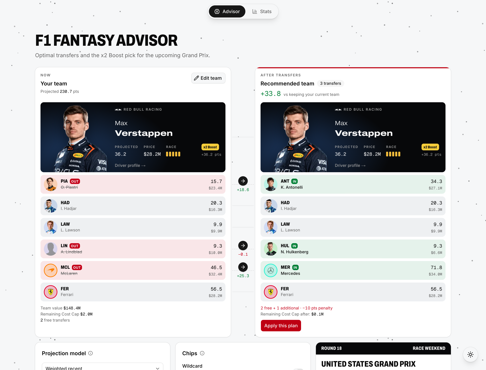
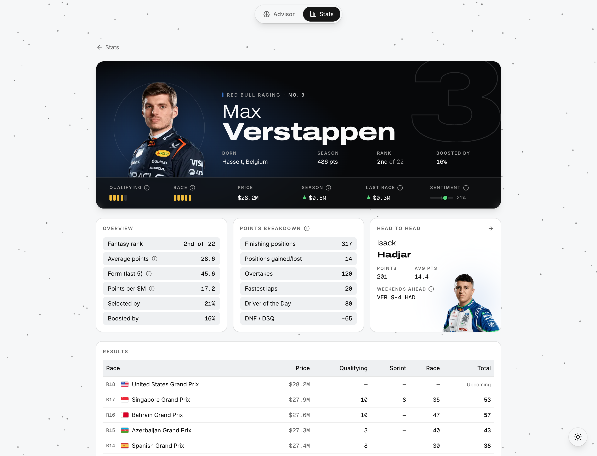
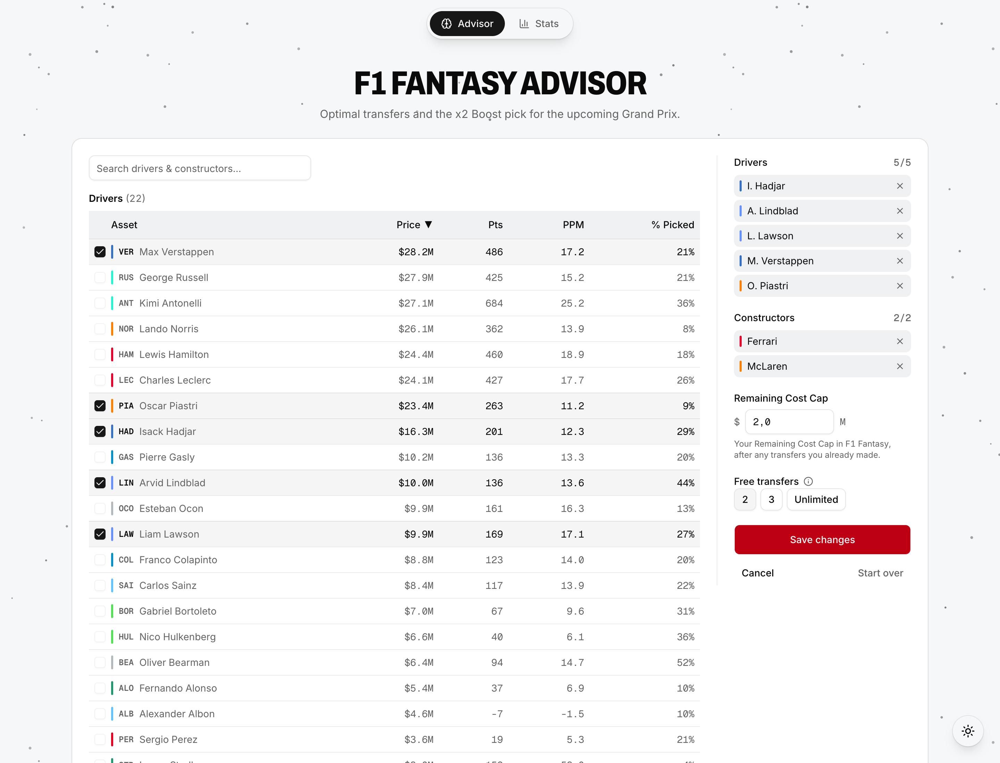
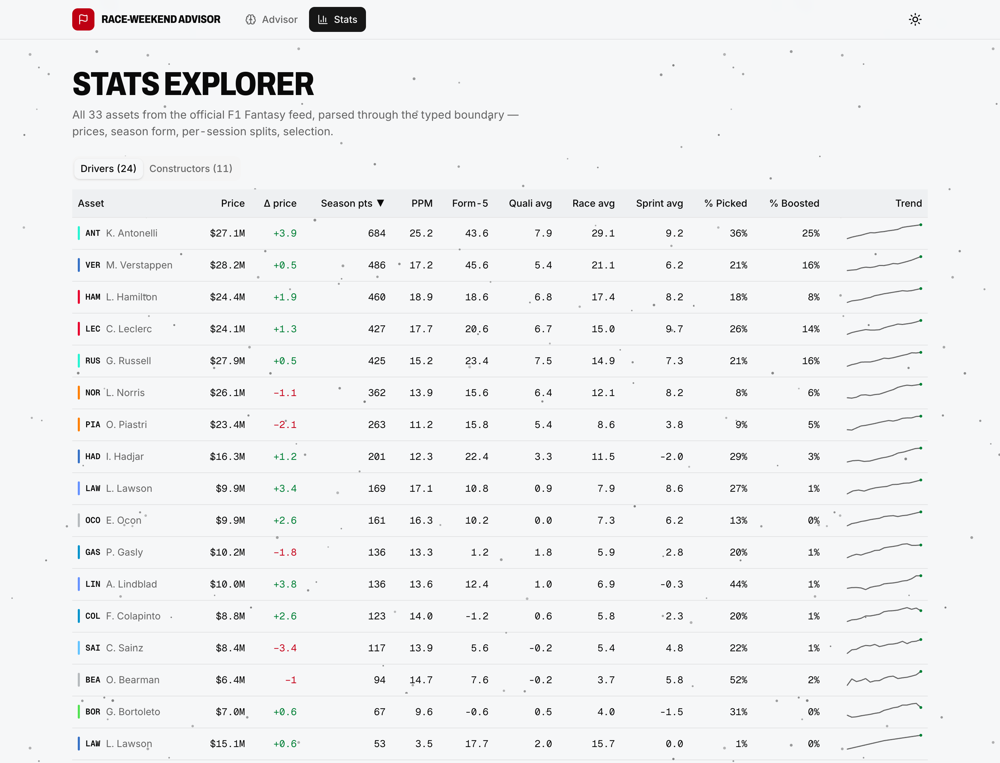

# F1 Fantasy Advisor

**The best F1 Fantasy transfers and x2 Boost pick for the next Grand Prix, worked out in your browser.**

**Live:** [f1.jarkovsky.com](https://f1.jarkovsky.com)

Enter your current team, your Remaining Cost Cap and your free transfers. The advisor projects how many points every driver and constructor will score at the next race. It then checks all 1,448,370 legal teams in about 6 ms and shows which transfers gain you the most points, after any transfer penalty, and who should get the x2 Boost.



## What you get

- **The payoff, highlighted.** Your team and the recommended one side by side, an arrow on every transfer, and the projected points you gain over keeping your team.
- **The true best team, not an estimate.** Every legal team is checked, so for the projection model you picked, no better team exists.
- **Five projection models.** From the season average to recent form, each explained in plain language in [How the projection models work](docs/projection-models.md).
- **Chip previews.** See what Wildcard or Limitless would change before you play them.
- **Stats and driver profiles.** Prices, form, per-session points and selection trends for the whole grid.
- **No account.** Your team is saved in your browser and nowhere else.

## Screenshots

| Driver profile                                         | Team setup                                      | Stats                                |
| ------------------------------------------------------ | ----------------------------------------------- | ------------------------------------ |
|  |  |  |

## How it works

1. **Data.** It reads the public F1 Fantasy feeds: prices, points per session and how many teams pick each driver. If a feed is down, it uses a saved copy instead of breaking.
2. **Projection.** The model you choose turns this season's points into an expected score for every driver and constructor at the next race.
3. **Search.** The optimizer checks every team that fits your Cost Cap and transfer rules, doubles the Boost driver's points, subtracts transfer penalties, and recommends the highest total.

The technical side (data flow, design decisions, benchmarks) is in [Architecture](docs/architecture.md).

**Built with** Next.js 16 · React 19 · TypeScript · Tailwind CSS v4 · shadcn/ui · zod · Vitest

## Run it locally

Requires Node ≥ 20.9 and pnpm.

```sh
pnpm install
pnpm dev
```

| Command             | What it does                   |
| ------------------- | ------------------------------ |
| `pnpm dev`          | Start the dev server           |
| `pnpm build`        | Production build               |
| `pnpm start`        | Serve the production build     |
| `pnpm test`         | Run the test suite             |
| `pnpm lint`         | ESLint                         |
| `pnpm format:check` | Prettier check                 |
| `pnpm typecheck`    | `next typegen && tsc --noEmit` |

## Credits & disclaimer

Unofficial fan project. Not affiliated with, endorsed by, or associated with the Formula One group of companies, the FIA, or F1 Fantasy. Driver imagery via [OpenF1](https://openf1.org) (CC BY-NC-SA); team logos via formula1.com, trademarks of their teams, shown only to identify them; schedule cross-checks via [Jolpica F1](https://github.com/jolpica/jolpica-f1); data from the public F1 Fantasy feeds.

The code is [MIT-licensed](LICENSE). The license covers the code only: the driver imagery, team logos, F1 names and marks, and the feed data in `data/` stay with their owners on the terms above.
