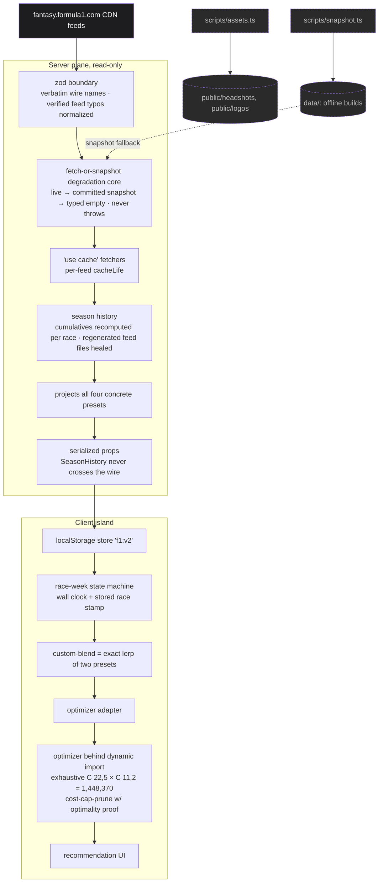

# Architecture

How the advisor is built, and why. For what the projection models do in plain language, see [How the projection models work](projection-models.md).

## Data flow



The server resolves a single streamed data hole: a fully cacheable async server component, with no `searchParams` and no wall-clock reads. It pre-computes the four concrete presets and ships serializable ingredients. The client island runs the race-week state machine itself, derives `custom-blend` by exact interpolation, and only then lazy-loads the optimizer.

## Key decisions

| Decision                                                                 | Why                                                                                                     |
| ------------------------------------------------------------------------ | ------------------------------------------------------------------------------------------------------- |
| Exhaustive search, cost-cap-only pruning with a written optimality proof | Score/upper-bound pruning deliberately omitted: it could cut a non-global per-transfer-count optimum    |
| Oracle-verified optimality                                               | Tested against a brute-force oracle, for the global optimum and every transfer bucket                   |
| Boost driver co-optimized for free                                       | The Boost driver is the max-projection term folded into the score, not a second pass                    |
| Money is integer tenths-of-a-million end to end                          | Exact cost-cap-boundary comparisons (cost == cost cap is affordable; one tenth more is not)             |
| Season cumulatives recomputed by summing per-race points                 | Feed totals are contaminated: old race files get regenerated with later-era cumulatives                 |
| Team lock from the raceday ISO8601 first-session start                   | `constraints.DeadlineDate` proved stale/advisory, so it is never trusted                                |
| Never recompute scoring from results                                     | The feed's per-race / per-session points suffice; no re-derivation                                      |
| Committed snapshots feed offline builds                                  | `'use cache'` fetchers fall back to `data/`, so `next build` never needs the live feeds                 |
| Sprint small-sample prior                                                | Sprint sessions are shrunk toward a prior (few samples per season)                                      |
| Equal PPM is per-race calibrated                                         | Divides by completed races so it sits on the single-race scale as a fallback                            |
| `custom-blend` = exact lerp of season-average and weighted-recent        | The engine's blend is linear in its endpoints, so SeasonHistory never has to ship                       |
| Race-week state machine runs client-side                                 | It needs the wall clock and the stored race; nothing time- or user-dependent sits in the static shell   |
| `localStorage`-only persistence                                          | No accounts, no backend; degrades silently when storage is blocked                                      |
| Light default via the `next-themes` pre-paint script                     | No flash of the wrong theme, and the static shell stays theme-free                                      |
| Text and surface tokens are designed as pairs                            | Muted-on-raised-grey and white-on-red-fill each fail AA if tuned alone; found by auditing both themes   |
| Your team beside the recommended team, on one CSS subgrid                | Each slot's current and recommended pick sit level, so every transfer reads as an arrow across the gap  |
| Picker = two kind tables + one shared search                             | A checkbox column is the a11y source of truth; sort/announce mechanics shared with the stats table      |
| Dot-pattern background generated by a seeded PRNG                        | The speckle SVGs are deterministic build inputs (`pnpm pattern`), not random output                     |
| Vocabulary taken from the game's own UI strings                          | Team, Boost, Cost Cap, % Picked; feed wire names (`CaptainSelectedPercentage`) stop at the zod boundary |
| Driver profiles prerendered per active driver                            | `generateStaticParams` over the feed; ratings are grid fifths, sentiment is the selection-% trend       |

## Optimizer performance

Microbenchmark on an Apple M1 Pro, Node 22: 1,448,370 candidate teams, 50 warm-up and 500 measured runs, 3 seeds. Reproduce with `pnpm bench`.

| Mode      | Min (ms) | Median (ms) | p95 (ms) |
| --------- | -------- | ----------- | -------- |
| Normal    | 4.826    | 6.267       | 7.246    |
| Wildcard  | 4.724    | 6.061       | 7.053    |
| Limitless | 6.632    | 6.872       | 7.204    |

Even at a 4× CPU throttle the search takes about 25 ms, so it runs on the main thread inside a `startTransition`, with no Web Worker.

## Offline builds

The build never needs the live feeds. With the feed pointed at an unreachable host, it still succeeds end to end and renders the committed snapshot data:

```sh
F1_FEED_BASE=http://127.0.0.1:1 pnpm build
```

## Other scripts

| Command         | What it does                                                              |
| --------------- | ------------------------------------------------------------------------- |
| `pnpm bench`    | Optimizer microbenchmark                                                  |
| `pnpm snapshot` | Refresh the committed feed snapshots in `data/`                           |
| `pnpm assets`   | Download headshots (OpenF1) and team logos (formula1.com); always exits 0 |
| `pnpm pattern`  | Regenerate the dot-pattern background SVGs (seeded, deterministic)        |
